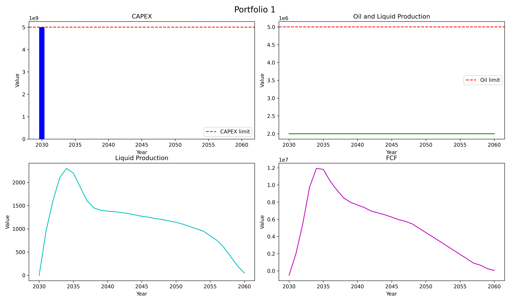
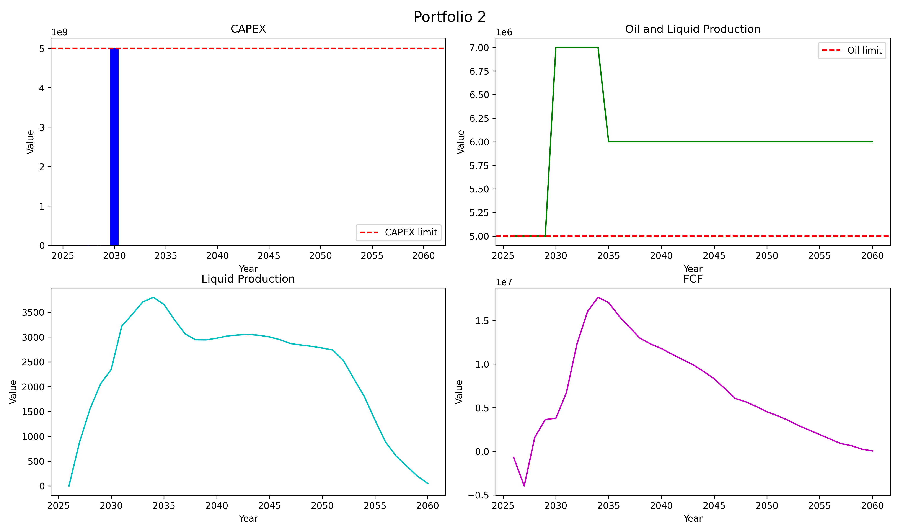
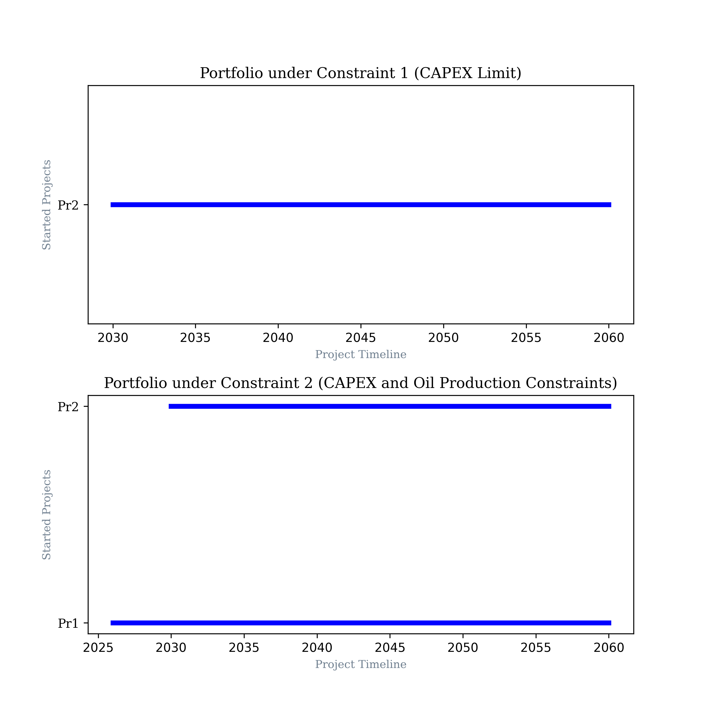
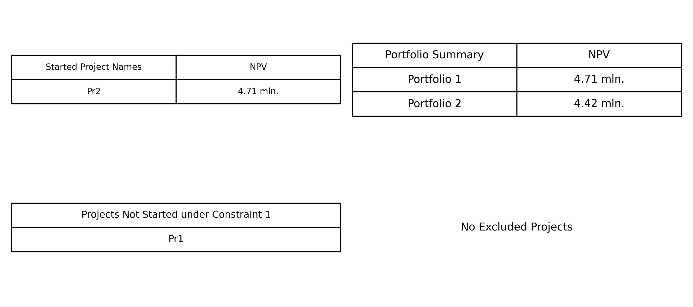

# Oil & Gas Portfolio Optimization

## Overview

This project is a Python-based tool for investment portfolio analysis and optimization in the oil and gas industry.

The tool processes a set of investment projects, evaluates their financial performance, and selects a portfolio of projects under annual capital expenditure and oil production constraints.

The main objective is to maximize the Net Present Value (NPV) of the selected portfolio while satisfying the specified operational and financial requirements.

## Business Problem

Each investment project is described by a set of annual technical and economic indicators:

- Oil production
- Liquid production
- Gas production
- Well commissioning
- Average active well stock
- Capital expenditures (CAPEX)
- Operating expenditures (OPEX)
- Revenue
- Free Cash Flow (FCF)

Projects may also have additional constraints:

- **Mandatory project flag** — indicates whether a project must be included in the portfolio.
- **Allowed launch period** — defines the earliest and latest years in which a project can be launched.

If no project-specific launch period is provided, the default range is 2026–2050.

The tool determines which projects should be included in the investment portfolio and identifies their launch years.

## Optimization Objectives

Two optimization scenarios are considered.

### Scenario 1: NPV Maximization under CAPEX Constraints

The objective is to maximize the total Net Present Value of the portfolio while ensuring that annual capital expenditures do not exceed 5 billion RUB.

**Objective function:**

$$
\max NPV_{\text{portfolio}}
$$

**Subject to:**

$$
CAPEX_t \leq 5{,}000{,}000{,}000,
\quad \forall t
$$

### Scenario 2: NPV Maximization under CAPEX and Oil Production Constraints

The second scenario introduces an additional operational requirement: annual oil production must be at least 5 million tons.

**Objective function:**

$$
\max NPV_{\text{portfolio}}
$$

**Subject to:**

$$
CAPEX_t \leq 5{,}000{,}000{,}000,
\quad \forall t
$$

$$
OilProduction_t \geq 5{,}000{,}000,
\quad \forall t
$$

Here, \(t\) represents each year of the planning horizon.

## Financial Model

### Net Present Value (NPV)

The NPV of an individual project is calculated as the discounted sum of its annual Free Cash Flow.

The business task specifies a discount rate of 18% and a mid-year discounting convention:

$$
NPV_i =
\sum_{t=0}^{T}
\frac{FCF_{i,t}}{(1 + r)^{t+0.5}}
$$

where:

- \(NPV_i\) — Net Present Value of project \(i\);
- \(FCF_{i,t}\) — Free Cash Flow of project \(i\) in year \(t\);
- \(r\) — discount rate (18%);
- \(t\) — number of years from the beginning of the planning period;
- \(T\) — final year of the planning horizon.

The total portfolio NPV is calculated as the sum of the NPVs of all selected projects:

$$
NPV_{\text{portfolio}} =
\sum_{i \in P} NPV_i
$$

where \(P\) is the set of selected projects.

### Project Launch Year and Profile Shifting

All project profiles are initially aligned to the year 2025.

When a project is assigned a different launch year, its technical and economic profiles are shifted by the corresponding number of years.

For example, if a project is shifted by two years, its original 2025 and 2026 values are moved to 2027 and 2028, respectively.

This affects both the annual aggregated portfolio indicators and the project's NPV.

### Portfolio Aggregation

The annual technical and economic indicators of the selected projects are aggregated by summing their values for each year:

$$
PortfolioMetric_t =
\sum_{i \in P} Metric_{i,t}
$$

This approach is used to calculate the combined CAPEX, oil production, liquid production, FCF, and other portfolio indicators.

## Optimization Methodology

The project includes two optimization approaches.

### 1. Greedy Optimization

The greedy algorithm evaluates projects based on their NPV-to-CAPEX ratio:

$$
Score_i =
\frac{NPV_i}{CAPEX_i}
$$

Mandatory projects receive additional priority.

Projects are sorted by their calculated scores. The algorithm then iterates through the projects, checks their possible launch years, and selects a feasible launch year based on the annual CAPEX constraint.

The resulting portfolio is used as an input to the subsequent optimization stage.

### 2. Linear Programming

The project also uses the PuLP optimization library to formulate an optimization problem with binary decision variables.

The decision variable represents whether a project is selected for a particular launch year:

$$
x_{i,y} \in \{0,1\}
$$

where:

- \(i\) — project;
- \(y\) — possible launch year;
- \(x_{i,y}=1\) — project \(i\) is selected and launched in year \(y\);
- \(x_{i,y}=0\) — otherwise.

The optimization objective is to maximize the total portfolio NPV:

$$
\max
\sum_i \sum_y NPV_{i,y} \cdot x_{i,y}
$$

The model considers alternative launch years, project selection decisions, and oil production requirements.

The greedy solution is also used to fix the launch decisions of projects already selected by the greedy algorithm.

The optimization problem is solved using the CBC solver through PuLP.

## Analytical Reporting

The project includes a separate analytics module for evaluating and visualizing the optimization results.

It generates the following reports:

### Portfolio Metrics

Comparative charts of the aggregated technical and economic indicators for the two portfolio scenarios:

- Annual CAPEX
- Oil production
- Liquid production
- Free Cash Flow

The charts also display the relevant CAPEX and oil production threshold lines.





### Portfolio Timeline

A timeline visualization showing the selected projects and their launch periods.



### Portfolio Comparison Tables

Tables containing project-level and portfolio-level information, including NPV values and excluded projects.



## Project Structure

```text
portfolio-optimization/
│
├── analytics/
│   ├── portfolio_metrics.py
│   └── portfolio_timeline.py
│
├── data/
│   ├── README.md
│   └── exam.xlsx
│
├── reports/
│   ├── README.md
│   ├── portfolio_1.png
│   ├── portfolio_2.png
│   ├── portfolio_tables.png
│   └── portfolio_timeline.png
│
├── src/
│   ├── optimization/
│   │   ├── __init__.py
│   │   ├── greedy.py
│   │   └── linear_programming.py
│   │
│   ├── __init__.py
│   ├── config.py
│   ├── data_loader.py
│   ├── npv.py
│   ├── portfolio.py
│   └── project.py
│
├── .gitignore
├── LICENSE
├── README.md
├── requirements.txt
└── run_portfolio_optimization.py
```

### Main Components

| Module | Description |
|---|---|
| `run_portfolio_optimization.py` | Main entry point for running the optimization workflow |
| `src/project.py` | Project data model |
| `src/data_loader.py` | Loading project data from Excel |
| `src/npv.py` | NPV calculation and project valuation |
| `src/portfolio.py` | Portfolio aggregation and CAPEX calculations |
| `src/config.py` | Global configuration and optimization parameters |
| `src/optimization/greedy.py` | Greedy portfolio selection algorithm |
| `src/optimization/linear_programming.py` | Linear programming optimization model |
| `analytics/portfolio_metrics.py` | Portfolio metrics and comparison charts |
| `analytics/portfolio_timeline.py` | Project timelines and portfolio comparison tables |

## Technologies

- **Python** — core programming language
- **Pandas** — data processing and analysis
- **NumPy** — numerical computations
- **PuLP** — mathematical optimization and linear programming
- **CBC** — optimization solver
- **Matplotlib** — data visualization
- **OpenPyXL** — Excel data processing

## Installation and Usage

### 1. Clone the repository

```bash
git clone <repository-url>
cd portfolio-optimization
```

### 2. Install dependencies

```bash
pip install -r requirements.txt
```

### 3. Run the optimization

```bash
python run_portfolio_optimization.py
```

The script loads project data from `data/exam.xlsx`, executes the optimization workflow, calculates portfolio metrics, and generates analytical reports.

## Key Outcomes

The project provides a framework for:

- Evaluating investment projects using discounted Free Cash Flow.
- Accounting for different project launch years.
- Selecting projects under annual CAPEX constraints.
- Incorporating oil production requirements into portfolio optimization.
- Comparing greedy and mathematical optimization approaches.
- Visualizing aggregated portfolio indicators and project launch timelines.

The resulting analytical reports support the comparison of alternative investment portfolio configurations and their financial and operational characteristics.